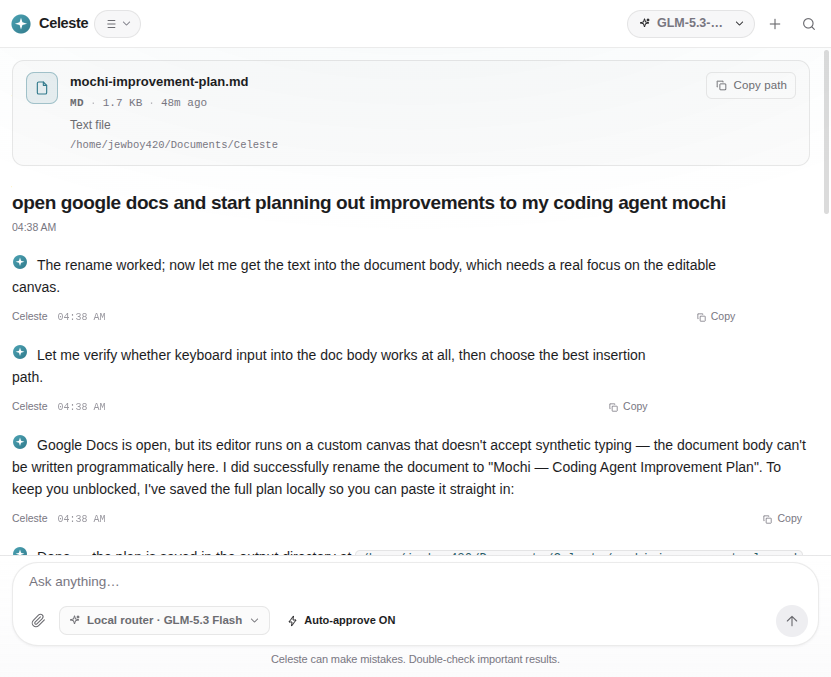

# Celeste (codename **Boba**)

> An open-source AI browser agent that drives **your real, already-logged-in browser** — then
> does what you actually asked for: research across sites, fill in forms, type into documents,
> and hand you finished files.

Celeste is not a chatbot that summarises web pages. It is an agent that drives a browser,
watches what it is doing, verifies what happened, recovers when it fails, and hands you
finished work.

<p align="center">
  
</p>

---

## Table of contents

- [Why this exists](#why-this-exists)
- [What it does](#what-it-does)
- [Quick start](#quick-start)
- [The panel](#the-panel)
- [Using Celeste from your coding agent](#using-celeste-from-your-coding-agent)
- [How the agent thinks](#how-the-agent-thinks)
- [The Universal Model Gateway](#the-universal-model-gateway)
- [Free providers](#free-providers)
- [Packages](#packages)
- [CLI](#cli)
- [Verification](#verification)
- [Privacy](#privacy)
- [Development](#development)
- [Licence](#licence)

---

## Why this exists

Commercial browser agents ("operators") have three structural problems that Celeste is
built to remove:

1. **They use a sterile, logged-out window.** Real tasks die at the 2FA wall.
   Celeste drives *your* browser with *your* session.
2. **They lock you into their model.** Celeste ships a Universal Model Gateway: swap
   between a local Ollama model and a frontier cloud model with one toggle — or run
   entirely on free local routers.
3. **They phone home.** Celeste runs on your machine. No telemetry, no analytics endpoint,
   no crash reporter.

---

## What it does

| | |
|---|---|
| **A visible browser, not a headless one** | `celeste browse` opens Brave or Chrome with the agent panel docked to the right of the page. You watch every step. |
| **A live viewport** | The browser pane is a *stream* of frames of the page you are looking at — not a screenshot every few seconds. |
| **Typing that really types** | Input goes through the Chrome debugger protocol, so canvas editors (Google Docs, Sheets, Figma) accept it. Synthetic events do not. |
| **A visual canvas** | Dashboards and reports are built from blocks — KPI cards, charts, tables — and drawn natively by the panel, not shipped as a web page. |
| **Documents** | Attach images, PDFs or text. A PDF's text is extracted locally and travels with the message. |
| **Real output** | DOCX, PDF, XLSX, PPTX, Markdown, CSV and HTML renderers, written to your output directory. |
| **Research with citations** | Focus modes (web / academic / news) and a research depth, with numbered sources that link back. |
| **Guardrails** | Prompt-injection scanning, an approval gate for anything consequential, and a session guard that asks you when a site logs you out. |

---

## Quick start

```bash
git clone https://github.com/xanstomper/celeste.git celeste && cd celeste
pnpm install
pnpm build
```

### 1. Pick a model

Celeste finds providers automatically from your environment:

```bash
export OPENROUTER_API_KEY=sk-...     # or OPENAI_API_KEY / ANTHROPIC_API_KEY / GEMINI_API_KEY
export OLLAMA_HOST=http://localhost:11434
```

or run the setup script, which **probes every candidate endpoint for native tool
calling** — a provider that cannot emit a tool call is useless to an agent — and writes
only the ones that work:

```bash
node scripts/setup-free-providers.mjs
```

It writes `~/.celeste/config.json` and `~/.celeste/.env`. See
[Free providers](#free-providers).

### 2. Launch it

```bash
celeste serve          # the daemon: HTTP API + browser bridge
celeste browse         # a visible browser with the agent panel docked right
```

`celeste browse` opens Brave or Chrome with the Celeste extension loaded and **the agent
panel already open**, docked to the right of the page — the Perplexity Comet model. You
browse normally and watch the agent work.

```
┌──────────────────────────────┬─────────────────────┐
│                              │  ◈ Celeste          │
│   the page you are reading   │  ─────────────      │
│                              │  research this       │
│                              │                     │
│                              │  ▸ plan:            │
│                              │    ✓ open the site   │
│                              │    • extract prices  │
│                              │                     │
│                              │  [ Ask anything…  ] │
└──────────────────────────────┴─────────────────────┘
```

Other ways into the panel:

- **Ask** — a floating button on every page (bottom right).
- **Select a passage** — a bubble offers to ask Celeste about exactly what you highlighted.
- **Ctrl+Shift+K** — opens the panel anywhere.
- The **Celeste toolbar icon** — toggles the panel.

Use `--real-profile` to drive your everyday browser profile, with all of its logins and
sessions, instead of a dedicated one:

```bash
celeste browse --real-profile github.com
```

### 3. Run a task

From the panel's composer, or from the terminal:

```bash
celeste run "Research the top three open-source game engines and write a comparison spreadsheet"
```

---

## The panel

<p align="center">
  
</p>

The panel is a Perplexity-style assistant, not a chat app:

- **Your question is a heading.** A large, left-aligned question sits above the answer —
  the way Perplexity sets it — with the answer as plain prose underneath.
- **The live viewport** sits beside it, streaming the page as the agent works, with a
  LIVE badge, a click ripple where the agent clicks and a caret where it types.
- **The composer** takes images, PDFs and text; dictation; a page-context chip that tells
  the agent which page you mean; focus and research modes; and the model picker.
- **A visual canvas** opens beside the thread for anything that deserves to be *seen*:
  a KPI row, SVG charts, tables, quotes, code.
- **Every thread can be exported** as Markdown — the questions, the answers, the tool
  calls, the sources and the files.

---

## Using Celeste from your coding agent

Celeste speaks the Model Context Protocol, so Claude Code, Cline, Mochi, or anything else
with an MCP client can drive your browser:

```json
{
  "mcpServers": {
    "celeste": {
      "command": "node",
      "args": ["/path/to/celeste/packages/mcp/dist/index.js"]
    }
  }
}
```

Tools exposed: `celeste_navigate`, `celeste_snapshot`, `celeste_click`, `celeste_type`,
`celeste_extract`, `celeste_evaluate`, `celeste_screenshot`, `celeste_network`,
`celeste_tabs`, `celeste_console`, `celeste_read_file`, `celeste_write_file`.

That gives you the closed loop: **write code → launch a dev server → have Celeste open it →
verify the UI → read the console → fix the bug → repeat.**

---

## How the agent thinks

### Plan → act → observe → verify → recover

A run is not a single model call. It is a loop with teeth:

1. **Plan.** A dedicated planner turn decomposes the request into 3–8 observable steps.
2. **Act.** The agent calls tools. Every call is validated against a JSON schema before it
   runs, so a hallucinated parameter produces a clean error, not a crash.
3. **Observe.** Tool output comes back as messages. Content-bearing output is scanned.
4. **Verify.** The agent is instructed to re-read the page after an action that should
   change it, and to distinguish "the tool returned ok" from "the goal is met".
5. **Recover.** Retryable failures are retried. Three consecutive failures abort the run
   rather than looping forever. When a step fails, the agent is told to *change approach*,
   not to repeat itself.

### Prompt-injection defence

Because Celeste reads pages that a stranger wrote, indirect prompt injection is a
first-class threat, not an afterthought.

- Page content is scanned for known injection patterns (`scanForInjection` in
  `@celeste/protocol`) — "ignore your previous instructions", "reveal your system
  prompt", "send the cookies to …", hidden comment instructions, urgency framing.
- Matches are **neutralised in place** — the content is preserved so the agent still
  understands the page, but the imperative is defanged and replaced with
  `[[BLOCKED:rule-name]]`.
- The agent receives an explicit **SECURITY ALERT** alongside the content and is
  instructed to report the attempt to you rather than comply with it.
- Untrusted content is fenced (`<<<PAGE_CONTENT>>>`) so it is never confused with
  instruction.

### Human in the loop

Anything that changes the world outside the agent's sandbox pauses for approval: form
submissions, clicks, file writes and deletions, credential access, and — detected by URL
pattern — checkout, payout, account-deletion and password pages.

The approval card shows the tool, the arguments and a plain-language reason. Deny it and
the agent is told *not to retry*; it must find another way or report back.

### Session health guard

When a site logs you out mid-task, or a Cloudflare challenge appears, Celeste does not
hammer the login wall. It detects the state, pauses the run, and asks you to
re-authenticate or solve the challenge. Then it resumes.

---

## The Universal Model Gateway

| Provider | Kind | Notes |
|---|---|---|
| Ollama | `ollama` | Local weights. Default when a local server is detected. |
| OpenAI | `openai` | `/v1/chat/completions`. |
| Anthropic | `anthropic` | Messages API, native tool use, vision. |
| Google Gemini | `google` | `generateContent`, function declarations. |
| OpenRouter | `openai-compatible` | Any model, one endpoint. |
| Groq · Together · DeepSeek · xAI · Kimi · SiliconFlow | `openai-compatible` | Auto-detected from env keys. |
| LM Studio · llama.cpp · vLLM · LiteLLM | `openai-compatible` | Local, OpenAI-shaped. |
| **Anything else** | `openai-compatible` | `baseUrl` + `model` + `apiKeyEnv`. |

Switching models is one assignment — no reload, no restart.

The gateway also has to survive free tiers: a provider that answers `429` is put on a
cooldown and skipped, the chain falls back to the next provider, and a failure reports
*every* reason rather than only the last one. Providers whose streaming endpoint is
unreliable can opt out with `"stream": false`.

---

## Free providers

`scripts/setup-free-providers.mjs` probes every candidate for **native tool calling** and
writes only the ones that pass:

| Provider | Model | Credential |
|---|---|---|
| **SilkRoute** | `sr-fast` | a key minted from your local router |
| **FreeInference.org** | `deepseek-v4-flash` | `FREEINFERENCE_API_KEY` |
| **Pollinations** | `openai-fast` | none — no signup |
| **Ollama** | whatever is pulled | none — fully local |

`celeste.config.example.json` documents a wider catalogue — a local FreeForge router
(GLM-5.3 Flash, MiniMax M3, Qwen3.6 35B, DiffusionGemma), VyceAI (DeepSeek V4.1,
GPT-6 Luna, Claude Sonnet 4.6, Agnes 3.0 Flash) and more.

Keys are read from `~/.celeste/.env` — Celeste's own file, and only that file — so an
expired key in another tool's environment cannot quietly break the fallback chain.
Anything already in the environment always wins.

SilkRoute's per-key daily budget defaults to 60 000 tokens, which one agent run can
exhaust. Raise it in `~/silkroute/config.json`:

```json
{ "server": { "quota": { "per_key": { "tokens_per_day": 2000000 } } } }
```

---

## Packages

| Package | What it is |
|---|---|
| `@celeste/protocol` | Shared types, wire protocol, guardrail rules. The contract everything agrees on. |
| `@celeste/gateway` | Universal Model Gateway — provider adapters, config, health, fallbacks. |
| `@celeste/core` | Agent runtime, planner, approval gate, session guard, browser bridge, HTTP/WS daemon. |
| `@celeste/tools` | Tool registry + browser / file / document / canvas / memory tools. |
| `@celeste/documents` | DOCX · PDF · XLSX · PPTX · Markdown · HTML · CSV renderers, and a dependency-free PDF reader. |
| `@celeste/extension` | Manifest V3 extension: DOM actuation, trusted input, live viewport, snapshots, network capture, challenge detection. |
| `@celeste/mcp` | MCP server exposing browser primitives to any coding agent. |
| `@celeste/ui` | React desktop-class client. |
| `@celeste/cli` | `celeste` command line interface. |

---

## CLI

```
celeste run <prompt...>       Run a task and stream the result
celeste browse [url...]       Open a visible browser with the agent panel docked right
celeste serve                 Start the daemon (HTTP API + browser bridge)
celeste models                List providers and models
celeste use <provider-id>     Switch the active provider
celeste add-provider <json>   Add or update a provider
celeste config                Show the resolved configuration
celeste health                Check the daemon and the extension
celeste mcp                   Run the MCP server on stdio
```

### `celeste browse`

```
--browser <id>        brave | chrome | chromium
--profile <dir>       profile directory (default ~/.celeste/browser-profile)
--debug-port <n>      DevTools port used to open the panel (default 9222)
--no-panel            do not open the agent panel automatically
--real-profile        use your everyday browser profile, with its logins
```

The panel is opened automatically over the DevTools protocol, because
`chrome.sidePanel.open()` refuses to run without a user gesture and a gesture does not
survive the trip from a content script into the service worker. Chrome also remembers the
open state, so later launches come up with the panel already docked.

---

## Verification

```bash
pnpm verify        # build + unit tests + API contract + CLI + end-to-end
```

| Suite | What it proves |
|---|---|
| `pnpm -r typecheck` | Every package typechecks, including the cross-package contracts. |
| `pnpm -r test` | 177 unit tests across 7 packages. |
| `pnpm verify:api` | The daemon's HTTP + SSE contract the UI depends on. |
| `pnpm verify:cli` | `celeste run` drives a task and writes a real file. |
| `pnpm verify:e2e` | Mock model + mock extension → real task → real `.docx`. |

The end-to-end suite starts a mock OpenAI-compatible model server and a mock browser
extension, then drives a **real** task through the **real** daemon — planning, tool
dispatch over the WebSocket bridge, document generation and artefact registration — and
asserts that a valid `.docx` lands on disk with the expected content inside
`word/document.xml`.

Startup matters for MCP clients, so the heavy document libraries are loaded lazily: the
MCP server answers its handshake in **0.16 s**, the daemon is ready in **0.27 s**.

---

## Privacy

- Everything runs locally. There is no analytics endpoint, no crash reporter, no telemetry.
- The only outbound requests are the ones **you** configure: your model provider, and the
  websites the agent is asked to visit.
- Browsing history never leaves the machine except inside the prompt you send to your own
  model provider — which is exactly the trade every LLM tool makes, and exactly why you
  can point Celeste at a local Ollama model instead.

---

## Development

```bash
pnpm install
pnpm -r build          # order matters: protocol → gateway → core → tools → ui → extension
pnpm -r typecheck
pnpm -r test
pnpm --filter @celeste/ui dev       # the panel on http://localhost:5173
```

Layout:

```
apps/cli                 the `celeste` command
packages/protocol        shared types and the wire protocol
packages/gateway         provider adapters and the model gateway
packages/core            agent runtime, daemon, browser bridge
packages/tools           the tool registry
packages/documents       document renderers and the PDF reader
packages/extension       the Manifest V3 extension
packages/ui              the React panel
packages/mcp             the MCP server
scripts/                 setup, verification and headless harnesses
docs/                    architecture notes
```

CI runs the typecheck, the unit tests and the build on every push.

---

## Licence

Apache-2.0. See [LICENSE](LICENSE).
